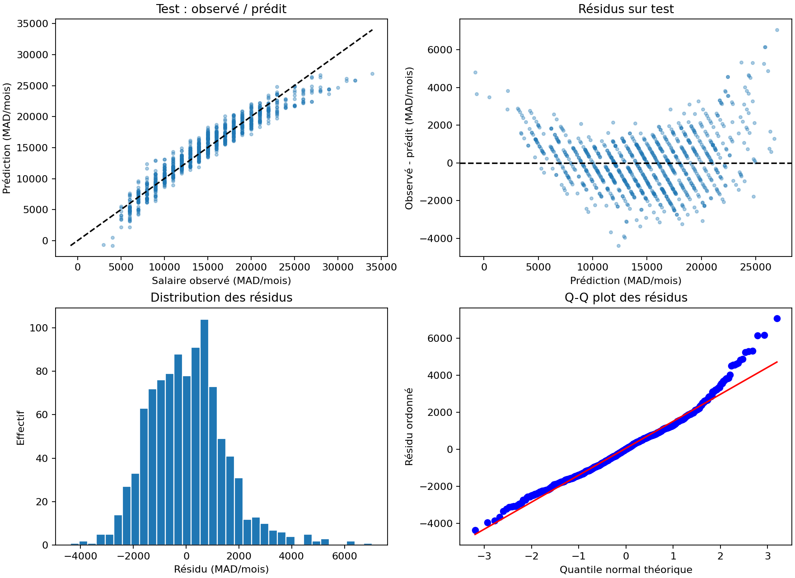
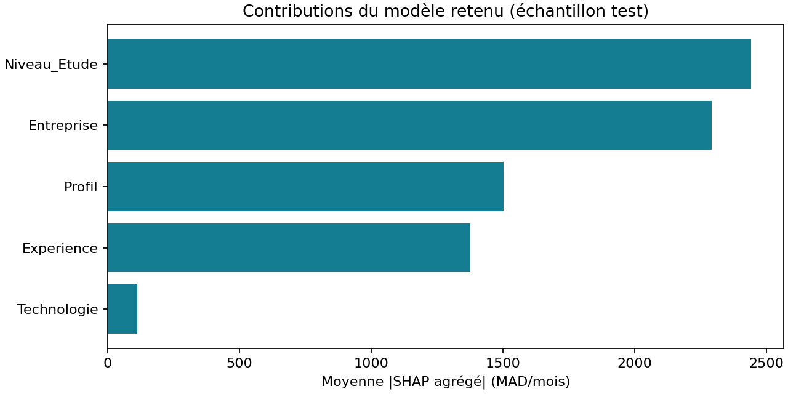

# Prédiction de salaire IT au Maroc

[](https://github.com/Marouanemounir/Prediction-de-Salaire-IT/actions/workflows/tests.yml)


**Une étude exploratoire de rémunération réunissant comparaison de modèles,
évaluation reproductible, incertitude et explications des prédictions.**

Le projet estime un salaire à partir de l'entreprise, du métier, de
l'expérience, du diplôme et de la technologie principale. Il associe une
régression linéaire implémentée en NumPy à des modèles scikit-learn, puis rend
les résultats consultables dans une application Streamlit et un rapport client.

> **Périmètre des résultats.** La provenance du CSV n'est pas vérifiée. Cette
> étude décrit les données du dépôt ; elle ne constitue pas une enquête
> représentative du marché marocain. Le caractère réel ou synthétique des
> observations reste indéterminé. [Consulter la fiche des données](docs/DATA_CARD.md).

[Démarrage rapide](#démarrage-rapide) · [Résultats](#résultats) ·
[Méthodologie](#méthodologie) · [Documentation](#documentation)

## Objectifs et fonctionnalités

- **Comparer** Linear Regression, Ridge, Lasso, Random Forest et Gradient
  Boosting, avec une référence NumPy from scratch et une baseline médiane.
- **Évaluer** les modèles sur un test distinct, avec R², MAE, RMSE et
  intervalles de confiance bootstrap.
- **Quantifier l'incertitude individuelle** avec des intervalles conformaux
  calibrés sur un jeu séparé et une couverture mesurée par segment.
- **Analyser les erreurs** avec les résidus, Jarque–Bera, un test du biais moyen
  et Breusch–Pagan/Koenker.
- **Expliquer** les prédictions avec SHAP, globalement et pour chaque simulation.
- **Restituer** les conclusions dans un rapport de rémunération incluant
  résultats, repères descriptifs, limites et recommandations de validation.

## Résultats

La sélection repose sur la **MAE moyenne en validation croisée sur le train**.
Les résultats du test sont publiés après cette sélection et ne servent pas au
réglage des hyperparamètres.

| Modèle | MAE CV · MAD/mois | R² test | MAE test · MAD/mois | RMSE test · MAD/mois |
|---|---:|---:|---:|---:|
| **Lasso** | **1 167** | **0,9247** | **1 143** | **1 470** |
| Ridge | 1 171 | 0,9239 | 1 149 | 1 477 |
| Linear Regression | 1 171 | 0,9239 | 1 149 | 1 477 |
| Linear from scratch | 1 171 | 0,9239 | 1 149 | 1 477 |
| Gradient Boosting | 1 272 | 0,9075 | 1 225 | 1 629 |
| Random Forest | 1 372 | 0,9019 | 1 274 | 1 677 |
| Baseline médiane | 4 165 | −0,0197 | 4 324 | 5 408 |

**Modèle retenu : Lasso, `alpha=1.0`.** Sur les 998 observations du test :

| Indicateur | Valeur |
|---|---|
| IC bootstrap à 95 % du R² | [0,9178 ; 0,9309] |
| IC bootstrap à 95 % de la MAE | [1 086 ; 1 198] MAD/mois |
| Intervalle de prédiction nominal à 90 % | Estimation ±2 433 MAD/mois |
| Couverture observée sur le test | 91,98 % |
| Largeur de l'intervalle | 4 866 MAD/mois |

Le R² mesure la variance expliquée, pas un taux de prédictions exactes.
Les écarts entre modèles linéaires sont faibles et ne démontrent pas une
supériorité statistique de Lasso. Les anciens scores annoncés dans le projet
sont remplacés par ce protocole ; les différences ne constituent pas un gain
mesuré à conditions égales.



Les diagnostics exploratoires rejettent la normalité et la variance constante
des erreurs. Le test du biais moyen ne rejette pas une moyenne nulle au seuil
de 5 %. Ces tests ne valident pas la représentativité des données.

[Rapport client complet](artifacts/rapport_client.md) ·
[Métriques détaillées](artifacts/metrics.json) ·
[Comparaison CSV](artifacts/model_comparison.csv) ·
[Résultats de validation croisée](artifacts/cv_results.json)

## Démarrage rapide

### Prérequis

- Python **3.12** et Git.
- Un environnement virtuel dédié.
- Un accès réseau pour installer les dépendances lors de la première utilisation.

### Installation sous Windows — PowerShell

```powershell
git clone https://github.com/Marouanemounir/Prediction-de-Salaire-IT.git
cd Prediction-de-Salaire-IT
python -m venv .venv
.\.venv\Scripts\python.exe -m pip install -r requirements-lock.txt
```

### Entraînement et lancement

```powershell
.\.venv\Scripts\python.exe -m salary_study.train
.\.venv\Scripts\python.exe -m streamlit run app_streamlit.py
```

Ouvrir **http://localhost:8501** dans le navigateur. Le premier entraînement
est nécessaire sur un nouveau clone : `artifacts/model.joblib` est généré
localement et n'est pas suivi par Git.

### Linux / macOS

Après le clonage, depuis le dossier du projet :

```bash
python3.12 -m venv .venv
.venv/bin/python -m pip install -r requirements-lock.txt
.venv/bin/python -m salary_study.train
.venv/bin/python -m streamlit run app_streamlit.py
```

L'environnement complet a été validé sous Windows avec Python 3.12.10.
`requirements-lock.txt` fige les versions installées ; `requirements.txt`
liste les dépendances directes et `requirements-dev.txt` ajoute pytest.
La compatibilité Linux/macOS de l'environnement complet reste à vérifier.

## Application Streamlit

L'interface propose trois onglets :

| Onglet | Contenu |
|---|---|
| Résultats de l'étude | Comparaison des modèles, métriques, médianes et quartiles par métier, téléchargement du rapport |
| Simulation et SHAP | Saisie d'un profil, estimation, intervalle individuel et contributions SHAP |
| Diagnostics et données | Graphiques des résidus, erreurs par segment, tests statistiques et fiche des données |

L'inférence utilise le même Pipeline que l'entraînement. Elle refuse les
catégories absentes du train et les expériences hors domaine. Une combinaison
profil/technologie jamais observée est signalée.



Les contributions sont regroupées sur les cinq variables d'origine.
Le programme vérifie que **référence + somme des contributions = prédiction**.
SHAP décrit le comportement du modèle ; il ne démontre pas de causalité.

## Données

| Caractéristique vérifiée | Valeur |
|---|---|
| Fichier | `DATASET_IT_MAROC_2025.csv` |
| Observations brutes | 5 000 |
| Doublons exacts exclus | 46 |
| Observations exploitées | 4 954 |
| Catégories | 20 entreprises, 10 profils, 65 technologies, 5 diplômes |
| Expérience observée | 0 à 15 ans |
| Salaire observé | 3 000 à 38 000 |
| Unité annoncée dans le dépôt | MAD/mois ; brut/net et primes non documentés |

Le CSV source est conservé intact. Aucun protocole de collecte, source primaire
ou plan d'échantillonnage n'est fourni dans les fichiers d'origine. Le nom
« 2025 » ne prouve pas la date réelle de collecte. Les noms d'entreprises ne
prouvent pas leur participation à une enquête.

Les descriptifs et prédictions concernent le fichier étudié. Ils ne permettent
pas d'établir une grille salariale représentative du Maroc.

## Méthodologie

1. **Audit et déduplication** : contrôle du schéma, valeurs finies et domaine,
   retrait des doublons exacts et empreinte SHA-256 du CSV.
2. **Séparation groupée** : 2 966 lignes d'entraînement, 990 de calibration et
   998 de test. Une combinaison des cinq entrées reste dans une seule partition,
   même si plusieurs salaires lui correspondent.
3. **Prétraitement dans chaque pli** : normalisation de l'expérience et encodage
   one-hot des catégories via un Pipeline scikit-learn.
4. **Sélection sur le train** : validation croisée groupée à cinq plis,
   grilles prédéfinies et minimisation de la MAE. Graine principale : 2025.
5. **Calibration du gagnant** : rayon conformal à partir des résidus absolus
   du jeu de calibration, au rang `ceil((n_cal + 1) * (1 - alpha))`.
6. **Évaluation finale** : métriques test, bootstrap de 1 000 réplications,
   diagnostics et couverture par segment. Aucun réentraînement après calibration.
7. **Explication SHAP** : 100 lignes train de référence et 200 lignes test
   expliquées, avec tirages déterministes et additivité contrôlée.

La régression NumPy conserve une implémentation pédagogique de la descente de
gradient, avec initialisation déterministe et calculs matriciels mis en cache.
Le notebook appelle les mêmes modules que la CLI pour éviter de maintenir
plusieurs versions du traitement.

Les intervalles conformaux sont marginaux sous hypothèse d'échangeabilité.
Leur largeur est constante et leur couverture n'est pas garantie par métier.
Par exemple, la couverture test observée pour le profil cybersécurité est de
83,17 %. Le regroupement des profils et les dépendances non documentées limitent
les garanties théoriques. Les IC bootstrap sont conditionnels au modèle figé
et ne mesurent pas les biais de collecte ou l'incertitude de réentraînement.

Consulter la [méthodologie détaillée et ses références](docs/METHODOLOGY.md).

## Reproductibilité et tests

```powershell
# Refaire l'étude dans un dossier distinct
.\.venv\Scripts\python.exe -m salary_study.train --output artifacts-check

# Exécuter les tests
.\.venv\Scripts\python.exe -m pytest -q
```

Les options de la CLI sont `--data`, `--output`, `--seed` et `--alpha`.
Par défaut : CSV fourni dans le projet, dossier `artifacts`, graine 2025 et
`alpha=0.10`. Streamlit lit le dossier `artifacts` du projet.

**Validation locale : 11 tests réussis**, dont le chargement de l'application
et la soumission du formulaire avec Streamlit AppTest. Les tests d'intégration
du modèle et de l'interface sont ignorés si le modèle local n'existe pas.
Deux entraînements ont reproduit à l'identique les partitions, métriques,
prédictions test et contributions SHAP exportées.

Un [workflow GitHub Actions](.github/workflows/tests.yml) exécute les tests sur
les push et pull requests. Son statut est disponible dans le badge en haut
de page. Le [compte rendu de validation](docs/VALIDATION.md) détaille les
vérifications locales et leurs limites.

## Architecture

```text
Prediction-de-Salaire-IT/
├── app_streamlit.py                     # Interface et simulation
├── DATASET_IT_MAROC_2025.csv             # Données source conservées
├── prediction_salaire_IT_MAROC_2025.ipynb # Parcours pédagogique
├── salary_study/
│   ├── data.py                         # Audit, groupes et partitions
│   ├── models.py                       # Pipelines et modèle NumPy
│   ├── train.py                        # Comparaison et évaluation
│   ├── uncertainty.py                  # Intervalles conformaux
│   ├── diagnostics.py                  # Métriques, bootstrap et tests
│   ├── explain.py                      # Contributions SHAP
│   ├── inference.py                    # Chargement et prédiction
│   └── reporting.py                    # Figures et rapport client
├── artifacts/                          # Résultats et modèle local
├── docs/                               # Méthode, données et code
├── tests/                              # Tests unitaires et intégration
├── .github/workflows/tests.yml          # Intégration continue
└── requirements*.txt                   # Dépendances
```

Les artefacts comprennent les métriques, paramètres CV, indices de partition,
prédictions test, contributions SHAP, graphiques et rapport client. Les versions
et empreintes sont consignées dans `artifacts/metadata.json`. Le modèle binaire
est exclu du suivi Git. Charger uniquement des modèles locaux fiables : joblib
utilise pickle pour la désérialisation.

L'ancien `model_salaire_IT_MAROC_2025.pkl` est conservé comme artefact historique
et n'est plus utilisé par l'application.

## Documentation

| Document | Usage |
|---|---|
| [Rapport client](artifacts/rapport_client.md) | Résultats, graphiques, repères descriptifs et recommandations |
| [Explication du code](docs/EXPLICATION_CODE.md) | Fonctionnement des modules et changements depuis le projet initial |
| [Fiche des données](docs/DATA_CARD.md) | Provenance, qualité, représentativité et pièces manquantes |
| [Méthodologie](docs/METHODOLOGY.md) | Protocole d'évaluation et références techniques |
| [Validation](docs/VALIDATION.md) | Vérifications réellement exécutées |

## Limites et prolongements

L'évaluation mesure la prédiction de nouveaux profils du même fichier ; elle
ne valide pas de nouvelles entreprises, de futures années ou une population
externe. Les villes, contrats, primes, temps de travail et dates de collecte
ne sont pas documentés. Les variables liées, notamment métier et technologie,
compliquent l'interprétation des contributions.

Avant un usage RH réel : documenter la source et les droits d'utilisation,
harmoniser la définition du salaire, collecter des observations représentatives
et récentes, puis effectuer une validation externe. Des intervalles adaptés à
l'hétéroscédasticité et une évaluation par entreprise sont des prolongements
possibles ; ils ne sont pas implémentés dans cette version.

## Auteur et licence

Projet de [Marouane Mounir](https://github.com/Marouanemounir).

Le README initial mentionnait MIT sans fichier `LICENSE`. La licence du code
et celle du CSV restent à clarifier par leur propriétaire avant redistribution
ou exploitation commerciale. Aucune licence de données n'est présumée.
